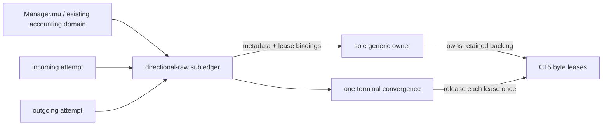

# Frozen lease-source v2 architecture

Status: `AUTHORED_NOT_GO`.

## 1. Ownership boundary

There is exactly one new logical object: a dedicated directional-raw subledger inside the existing `Manager` accounting domain and protected by existing `Manager.mu`. It records reservations, component-to-lease bindings, transfers, aliases, releases, and refusal facts. It owns no backing independently of the existing sole `callHierarchyLayer1GenericOwner`, creates no second recorder or terminal, and cannot issue capacity without a corresponding C15 lease.

The existing generic owner remains direction-neutral and the sole terminal/backing owner. Incoming and outgoing remain independent attempts and contracts. The subledger never merges their identities, evidence, semantics, reviews, totals, or GO.



## 2. Exhaustive component charge table

Every live retained backing is exactly one owned copy or one bounded alias. “Capacity” means the exact retained backing capacity charged by its corresponding lease, not logical JSON length unless those are identical by the allocator contract.

| Component | Owned-copy rule | Alias rule | Required binding |
|---|---|---|---|
| prepare frame | reserve before frame acquisition/copy | zero charge only as a bounded view | owning lease for exact capacity |
| prepare result | reserve before result acquisition/copy | zero charge only as a bounded view | owning lease for exact capacity |
| selected handoff | reserve before any copied handoff | zero-charge span tied to prepare-result lease | owner lease ID + offset/length |
| directional frame | reserve before assembly/copy | zero charge only if transport accepts bounded owner view | owning lease for exact capacity |
| directional result | reserve before result acquisition/copy | zero charge only as a bounded view | owning lease for exact capacity |
| retained external/evidence | reserve before retained copy/publication | zero charge only while bounded by owning lease lifetime | owning lease for exact capacity |

No component may be omitted because it shares bytes, a digest, source form, direction, or operation with another component. Shared backing is represented as aliases to one owning lease, not duplicate owners or hidden copies.

## 3. Reservation before owned copy

Before every operation that may create an owned copy, call reservation with the exact tuple:

```text
(component, bytes, attempt_id, account_id)
```

The reservation validates active attempt/account/component, checked byte arithmetic, per-attempt and aggregate limits, and absence of an existing owning binding before allocation, read retention, assembly, publication, or other avoidable effect. Exactly-at-limit may proceed; plus one and overflow refuse before effect. Refusal records preallocation/publication/effect counters as `+1` for the reached refusal class while leaving live bytes, slots, ownership, source, destination, and leases unchanged.

Failure precedence is exact and first-match:

1. invalid/nil/stale/foreign attempt or account;
2. terminal/released state;
3. invalid or duplicate component binding;
4. arithmetic overflow;
5. per-attempt limit;
6. aggregate/account limit;
7. source/lease validation;
8. allocation/acquisition failure;
9. publication/effect failure;
10. terminal race.

A later condition never replaces an earlier reached failure. Refusal is not release and does not select a semantic terminal beyond the exact frozen terminal policy.

## 4. Lease-bearing acquisition and no escape

Every acquisition returns one inseparable result carrying:

```text
AcquisitionResultV2 {
  attempt_id, account_id, component,
  bytes, capacity,
  leases[],
  ownership = OWNED | ALIAS,
  alias_of?, source_form, digest,
  valid
}
```

For `OWNED`, `leases` is nonempty and its exact active capacity sum equals the charged retained capacity. For `ALIAS`, no new charge is present; `alias_of` identifies an active owning lease plus a validated offset/length bounded by that lease. Aliases cannot outlive, transfer independently from, publish independently from, or be reconstructed after the owning lease is invalidated.

No API returns raw bytes separately from the result. No field extraction, slice retention, callback, publication, observation, evidence record, or asynchronous use may let bytes escape the result’s lease lifetime. Digest, length, source locator, remarshal, parse tree, or regeneration cannot reconstruct or substitute retained raw bytes.

## 5. Atomic transfer

Transfer input and output are whole acquisition results. Under the complete nested order `Manager.mu -> callHierarchyLayer1GenericOwner.mu -> privateB4ByteAccountV2.mu`, success validates source, destination, component, attempt/account, all leases, capacity, aliases, and terminal state; installs destination bytes and lease bindings; then invalidates source bytes, aliases, leases, and `valid` in the same critical section. The account lock is acquired only while Manager and owner locks are already held, and is released first.

```text
success: one valid destination owner; source bytes+lease invalid
failure: source remains the one valid owner; destination unchanged
never: two valid owners, zero valid owners, split byte/lease ownership, partial move
```

An alias may be rebound only as another bounded alias to the same live owning lease. Turning an alias into owned storage requires a new pre-reserved owned copy and lease.

## 6. Terminal convergence and release

Normal completion, complete-empty, malformed, protocol/transport failure, unsupported, timeout, cancellation, refusal after admission, explicit lease release, owner `requestTerminal`, STOP, RESTART, Shutdown, stale generation, callback/view/handoff race, and duplicate release all converge on one Manager terminal-release operation.

The winner enters under `Manager.mu`, then `callHierarchyLayer1GenericOwner.mu`, and acquires `privateB4ByteAccountV2.mu` only for nested lease discharge/account mutation:

1. freezes the immutable terminal if not already selected;
2. marks the attempt closing;
3. invalidates all aliases and acquisition handles under Manager/owner protection;
4. clears every retained byte reference;
5. under the nested account lock, releases each corresponding lease exactly once and applies account counters;
6. releases the account lock before owner and Manager locks;
7. checks component/account live totals reach their exact post-release values;
8. assigns one nonzero release identity;
9. removes the active attempt/slot and makes reuse available only under a fresh identity.

The account release primitive used here must be non-callback, non-blocking, and incapable of acquiring owner or Manager locks. Account reserve/alias/transfer/release paths that begin while holding `privateB4ByteAccountV2.mu` may mutate account-local state or return, but must never acquire owner or Manager locks; they must instead drop the account lock and re-enter through the Manager-owned operation. Terminal-release losers return false/no-op. They cannot change terminal, release identity, counters, leases, or backing. Required postcondition: no double release, orphan lease, retained byte reference, valid stale alias, or reusable old attempt identity.

## 7. Copy/alias policy

- Owned copy: new retained backing, mandatory prior reservation, exact active lease, one charge.
- Alias: bounded `(owner_lease_id, offset, length)` view, zero charge, no independent lifetime or publication.
- Transfer: atomic movement of the complete bytes+lease result, no new charge.
- Borrow: synchronous bounded use under the owning lease; cannot be stored or returned.
- Release: exact-once invalidation and lease discharge.

Forbidden: reconstruction; remarshal-as-original; digest-as-bytes; capacity inferred after allocation; uncharged retained copy; lease-free byte return; alias escape; hidden scratch retained beyond the operation; publication before reservation; and converting metadata/subledger reservation into a backing owner.

## 8. Concurrency and lock order

The sole complete order for any nested operation is:

```text
Manager.mu -> callHierarchyLayer1GenericOwner.mu -> privateB4ByteAccountV2.mu
```

A path may hold a prefix of that order, but never invert or skip backward. In particular:

- owner-held code never acquires `Manager.mu`;
- account-held code never acquires owner or Manager locks;
- owner-held code may acquire the account lock only when it already holds Manager lock;
- account callbacks, waits, retries, or terminal dispatch are forbidden;
- locks release in reverse order: account, owner, Manager.

No callbacks, waits, provider operations, allocations, hashing, or external publication run while nested locks are held; only bounded in-memory validation, install/invalidation, account counter mutation, and non-callback lease discharge are allowed. Terminal release uses this complete order and is the only cross-domain discharge coordinator.

Rejected alternatives:

1. `privateB4ByteAccountV2.mu -> owner.mu -> Manager.mu`, or any account-held acquisition of owner/Manager: rejected for lock inversion and terminal/reservation deadlock.
2. `owner.mu -> Manager.mu -> account.mu`: rejected because generic terminal paths already begin at owner and would invert Manager ownership.
3. release account leases after dropping Manager/owner locks: rejected because a reserve/reuse race could observe cleared backing with undischarged capacity or discharged capacity with valid aliases.
4. account callback into terminal release: rejected because it creates reverse acquisition and a second terminal coordinator.
5. try-lock, timeout, goroutine, channel, or deferred asynchronous discharge: rejected because failure becomes schedule-dependent and exact-once release/accounting is no longer atomic.
6. a second account/owner/terminal solely to avoid nesting: rejected as duplicate custody and authority.

No new mutex, goroutine, channel, recorder, or terminal is authorized.

## 9. Invariants

```text
I1  exactly one directional-raw subledger in Manager accounting domain
I2  exactly one generic backing/terminal owner
I3  each owned component has one prior exact reservation and corresponding active lease(s)
I4  each live backing identity has exactly one owning classification
I5  alias charge = 0 and alias lifetime <= owning lease lifetime
I6  transfer success preserves exactly one valid owner; failure preserves source only
I7  sum(component owned capacities) = attempt live bytes = active lease capacity sum
I8  no reservation/subledger row is itself C15 backing
I9  every terminal/race converges on one release identity
I10 every lease releases once; no byte/alias survives release
I11 incoming and outgoing identities/evidence remain independent
I12 authority=0, default off, CALLS_ONLY, D/R unchanged
I13 complete lock order is Manager -> owner -> account; reverse/account-held upward acquisition is impossible
I14 terminal discharge is atomic across alias invalidation, backing clear, lease release, and account counters
```

Any invariant violation is a hard stop, not a recoverable fallback.
