# Reviewed architecture: dedicated directional subledger

## Evidence and decision

Assumption and basis: current source fixes `privateB4MaxOwnedBytes = 32 << 20`, keeps the legacy `privateB4ByteLedger` at 24,600 bytes, wraps it in V2 without changing its 1,024 general entries, and releases it through the existing account/Manager terminal path. The requirements demand a separate exact directional bucket while preserving that behavior. Therefore this package selects a dedicated directional subledger in the same `Manager` accounting domain and rejects a shared enlarged bucket.

### Models evaluated

| Model | Result | Rationale |
|---|---|---|
| Dedicated directional subledger | **SELECTED** | Preserves the existing/general C15 partition and 24,600-byte legacy representation; permits an independent one-slot 32 MiB directional policy under the same Manager/account recorder and terminal authority. |
| One shared enlarged C15/general bucket | **REJECTED** | Makes ordinary existing/general reservations compete with directional reservations, changes refusal/reuse behavior, obscures partition identity, and cannot prove D/R/generic compatibility. |

A simple increase of `privateB4MaxOwnedBytes` is separately **REJECTED**: it changes the existing partition rather than creating the required exact directional partition, silently increases all current consumers, and provides neither one-slot identity nor cross-partition refusal.

## Frozen capacities and arithmetic

```text
existing/general partition maximum = 33,554,432 bytes
transaction legacy ledger layout   =     24,600 bytes (already charged inside existing/general live accounting)
directional partition maximum      = 33,554,432 bytes
Manager combined maximum           = 67,108,864 bytes
                                  = 33,554,432 + 33,554,432
```

Checked proof for unsigned accounting:

```text
E <= 33,554,432
D <= 33,554,432
E <= MaxUint64 - D
C = E + D
C <= 67,108,864
```

Reservation refuses before effect if any check fails. The 24,600-byte legacy table is not added again: it is already part of `E`. Directional metadata must be charged to the directional reservation if retained; no uncharged third pool exists. One directional slot means `D` belongs to at most one active incoming or outgoing attempt.

## Ownership and identity

- The same `Manager` owns both partition ledgers and is the sole accounting recorder/coordinator.
- `privateB4ByteAccountV2` remains the existing/general C15 capacity authority; the directional subledger is a distinct Manager-owned partition with exact lease bindings.
- `callHierarchyLayer1GenericOwner` remains the sole backing and terminal owner. No second recorder, owner, or terminal is introduced.
- Account identity is the Manager-local accounting-domain identity.
- Partition identity is immutable: `GENERAL_C15_V2` or `DIRECTIONAL_RAW_V1`.
- Attempt identity is `(manager_generation, directional_sequence, direction, profile, target_set)` and is fresh after release/restart.
- Reservation identity is `(account_id, partition_id, attempt_id, reservation_generation)`.
- Alias identity binds `(reservation_id, owner_lease_id, offset, length, owner_lifetime_id)` and therefore the same partition. Aliases charge zero.
- Cross-partition transfer, lease rebinding, capacity borrowing, and release-offsetting are prohibited. A copy across partitions requires a new destination reservation before allocation and leaves the source independently charged until source release.

Incoming and outgoing use separate profile, attempt, semantic result, target-set, evidence, review, and terminal records. They share only checked arithmetic, one-slot admission, component mechanics, refusal classes, and release machinery.

## Reservation and failure precedence

All checks occur under `Manager.mu` before read, allocation, copy, hash, publication, provider write, owner mutation, account mutation, or scheduling. Failure leaves bytes, slots, identities, leases, source, destination, cumulative counters, and terminal state unchanged except for one bounded refusal fact.

| Order | Condition | Refusal | Pre-effect postcondition |
|---:|---|---|---|
| 1 | disabled, wrong profile, non-CALLS, nil/invalid/foreign/stale account or attempt | `INELIGIBLE_OR_IDENTITY` | no partition lookup side effect |
| 2 | Manager closing, generation stale, STOP/RESTART/Shutdown begun, attempt terminal/released | `TERMINAL_OR_LIFECYCLE` | no admission/reuse |
| 3 | invalid direction/component/partition, duplicate component, cross-partition transfer/alias | `PARTITION_OR_COMPONENT` | no lease/owner mutation |
| 4 | directional slot occupied | `DIRECTIONAL_SLOT_BUSY` | existing attempt unchanged |
| 5 | requested or aggregate checked-add overflow | `ARITHMETIC_OVERFLOW` | counters unchanged |
| 6 | requested or attempt directional total > 33,554,432 | `DIRECTIONAL_LIMIT` | no effect |
| 7 | existing/general total > 33,554,432 | `GENERAL_LIMIT` | current C15 behavior unchanged |
| 8 | checked combined total > 67,108,864 | `MANAGER_COMBINED_LIMIT` | both partitions unchanged |
| 9 | source/lease/alias/acquisition validation | `SOURCE_OR_LEASE` | source remains owner |
| 10 | allocation/acquisition | `ACQUISITION` | reservation rolls back atomically |
| 11 | publication/provider effect | `PUBLICATION_OR_EFFECT` | terminal convergence, no semantic partial result |
| 12 | terminal race | `TERMINAL_RACE` | one terminal winner; loser no-op |

Earlier reached causes win; later causes cannot relabel them. Exact 33,554,432 directional and exact 67,108,864 combined totals are admitted if all earlier guards pass; plus one refuses at the corresponding row.

## Lifecycle

```mermaid
stateDiagram-v2
  [*] --> Disabled
  Disabled --> Reserved: eligible + slot free + checked limits
  Reserved --> Active: leases/backing installed atomically
  Active --> Closing: normal/error/cancel/release/STOP/RESTART/Shutdown/stale
  Reserved --> Closing: admitted refusal or race
  Closing --> Released: clear aliases/bytes; release leases; decrement directional slot/bytes
  Released --> Reusable: terminal settled under Manager
  Reusable --> Reserved: fresh generation + fresh attempt/reservation IDs
  Closing --> Closing: duplicate terminal/release is no-op
```



STOP closes new directional admission and converges every attached generic owner. RESTART first completes old-generation release and settlement, then constructs a fresh Manager generation; no directional byte or identity crosses generations. `Shutdown` closes admission, cancels/waits workers, detaches owners, requests/waits the same terminal path, then requires both partitions quiescent. Context cancellation uses the same path and cannot orphan leases. Explicit release clears aliases and retained byte references before exact-once lease and counter release. Reuse occurs only after settlement and always receives fresh attempt, reservation, release, and lease-generation identities.

```mermaid
sequenceDiagram
  participant C as Incoming/Outgoing caller
  participant M as Manager.mu
  participant O as Generic owner.mu
  participant A as C15/account lock
  C->>M: reserve(direction, attempt, bytes)
  M->>M: identity, slot, overflow, partition, combined checks
  M->>O: bind sole terminal/backing owner
  O->>A: bind exact leases/capacity
  A-->>O: active lease set
  O-->>M: acquisition installed
  M-->>C: reservation/acquisition
  C->>M: terminal/cancel/release
  M->>O: freeze terminal; invalidate aliases; clear bytes
  O->>A: release each lease once
  A-->>O: counters reconciled
  O-->>M: owner settled
  M-->>C: release identity; slot reusable with fresh generation
```

Lock order remains `Manager.mu -> callHierarchyLayer1GenericOwner.mu -> privateB4ByteAccountV2.mu`; no callback, provider work, allocation, wait, channel, goroutine, or hashing occurs under nested locks.

## Compatibility and API impact

Authority remains `0`; source completeness remains `UNKNOWN`; accepted remains false. Default-off, `CALLS_ONLY`, D/R, generic Layer 1, public schemas, CLI/MCP/registry/profile defaults, readiness history, predecessor commitments, and generic lineage remain byte/value unchanged.

The next production-interface successor may add private Manager fields for the directional ledger, manager/account/partition/attempt/reservation/release IDs, one slot, live/cumulative counters, refusal facts, and six component bindings. It may add package-private reserve/copy/alias/transfer/release methods and typed private values. No exported API or exact Go declaration/compile contract is frozen here.

AUTHORED_NOT_GO
